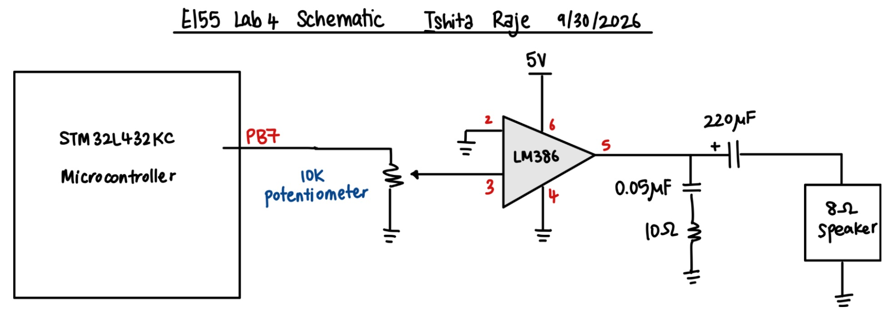

# Introduction 
In this lab, I developed a C program for the STM32L432KC Microcontroller to generate musical notes using hardware timers built into the MCU. Each note was represented by a frequency in Hertz and a duration in milliseconds. TIM16 was used to control the pitch by determining when the speaker output pin should toggle, while TIM15 was used to control how long each note lasted. This separated the timing of each square-wave cycle from the timing of the overall melody.

The program used the onboard MCU-controlled GPIO pin PB7 as the digital audio output for an LM386 amplifier and an 8Ω speaker. The uploaded version contains the Für Elise song and an alternative arrangement of 'Mary Had a Little Lamb'. The main goals were to implement memory-mapped timer drivers, relate the timer settings to the resulting pitches and durations, and evaluate the accuracy of the notes being generated.

# Design and Testing Methodology

## Hardware Design

The STM32L432KC generated the square-wave input to the LM386 amplifier, which drove the 8Ω speaker. I used PB7, configured as a GPIO output, to send the square-wave signal to the amplifier and connected the microcontroller and amplifier grounds together. The amplifier was powered by a 5V supply. I also used a volume potentiometer to adjust the sound coming from the speaker. Turning it one way reduced the volume to zero, while turning it the other way made the speaker very loud. The microcontroller determined the note frequency and duration, while the amplifier drove the speaker.

## C Code Structure

The program was divided into separate files for clock configuration, GPIO control, and the two timers. Each timer had a header file containing its register definitions and function declarations, and a source file containing its initialization and playback functions. `main.c` combined these functions to read the musical score and generate the output.

### Clock and GPIO Configuration

At the beginning of `main()`, `setFlashLatency(4)` configured the flash memory for operation at the higher clock speed. The program then called `configurePLL(PLLSRC_MSI, 1, 40, 2)` and `selectSysclk(SW_PLL)` to produce an intended system clock of 80 MHz from the 4 MHz MSI oscillator. With the bus prescalers unchanged from their reset settings, both timers also received an 80 MHz clock.

The GPIOB clock was enabled through `RCC->AHB2ENR`. The program then used `pinMode()` to configure PB7 as an output and `digitalWrite()` to initialize it low.

### Memory-Mapped Register Access

The timer headers defined the base addresses of TIM15 and TIM16 as `0x40014000` and `0x40014400`, respectively. Register structures and pointer macros allowed the program to access registers using expressions such as `TIM15->PSC` and `TIM16->ARR`. The register fields were declared `volatile` so that the compiler preserved accesses to hardware registers, including status flags that could change independently of the program.

The main registers used were the prescaler (`PSC`), auto-reload register (`ARR`), control register (`CR1`), event-generation register (`EGR`), and status register (`SR`).

### TIM16: Pitch Control

TIM16 controlled the frequency of each note. `TIM16_init()` enabled the timer clock and set its prescaler to 79, dividing the 80 MHz input by 80 to create a 1 MHz counter clock.

`TIM16_play(frequency)` calculated the number of timer counts required for half of the requested square-wave period and set `ARR` accordingly. The calculation included rounding to the nearest integer to reduce pitch error.

Whenever TIM16 overflowed, its update flag (`UIF`) became set. The main loop checked this flag, cleared it, and called `togglePin()` to change PB7’s output state. Two toggles produced one complete square-wave cycle. Therefore, this implementation used timer-controlled software toggling rather than a hardware PWM output.

### TIM15: Duration Control

TIM15 controlled how long each note played. I set `PSC = 7999` to obtain a 10 kHz counter clock, so each count represented 0.1 ms. For a note duration of `duration_ms`, I set

$$
ARR = 10\,duration_{ms}-1.
$$

For example, a 125 ms note required 1250 timer counts, so `ARR = 1249`. Once TIM15 reached its overflow, the main loop stopped playing that note and moved to the next one.

Both timer playback functions generated an update event to initialize the new timing settings, cleared the resulting update flag, and enabled the counter.

### Main Playback Loop

The melody was stored as a two-dimensional array containing frequency–duration pairs. For each entry, the program drove PB7 low, configured TIM16 for the requested pitch, and started TIM15 for the requested duration. It then polled both timers, toggling PB7 on TIM16 updates until TIM15 indicated that the note was complete.

A frequency of zero represented a rest. In this case, TIM16 was disabled before the frequency calculation, preventing division by zero, and PB7 remained low while TIM15 measured the pause. A duration of zero marked the end of the song. Once this entry was reached, both timers were disabled and PB7 was held low.

Für Elise was selected in the uploaded program. Mary Had a Little Lamb was included as a commented-out alternative that could use the same playback functions. I tested the playback of both of these songs, and hacing both of them stored as frequency-duration pairs allowed me to swicth songs without chnaging any timer logic. 

## Testing Methodology

I tested the system by listening to the songs through the speaker. I was able to play both *Für Elise* and *Mary Had a Little Lamb* using the same timer functions. I also tested the volume potentiometer and found that it provided a wide range of volume control, from silent at one end to very loud at the other. This let me adjust the speaker volume without changing the frequencies or durations in the code.

# Conclusion
This lab helped me understand how to use two timers at the same time for separate tasks. TIM16 determined the time between output toggles, which controlled pitch, while TIM15 determined when to move on to the next note. Keeping the score as frequency–duration pairs also made the program easier to modify and test with different melodies. I was able to play both songs through the amplifier and adjust the loudness using the potentiometer. The main takeaway was learning how to configure and coordinate two timer peripherals on the MCU for different tasks instead of relying on software deay loops to play desired frequencies and durations. 