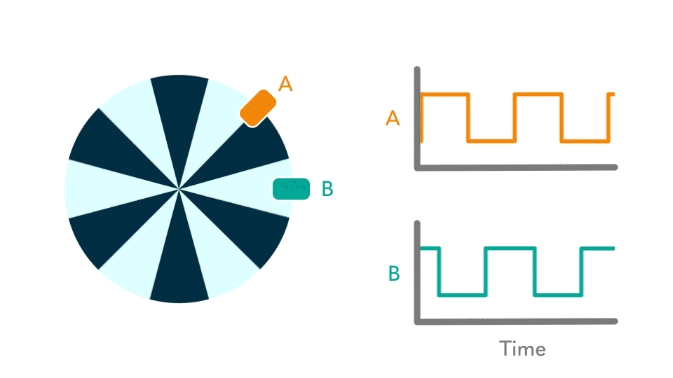
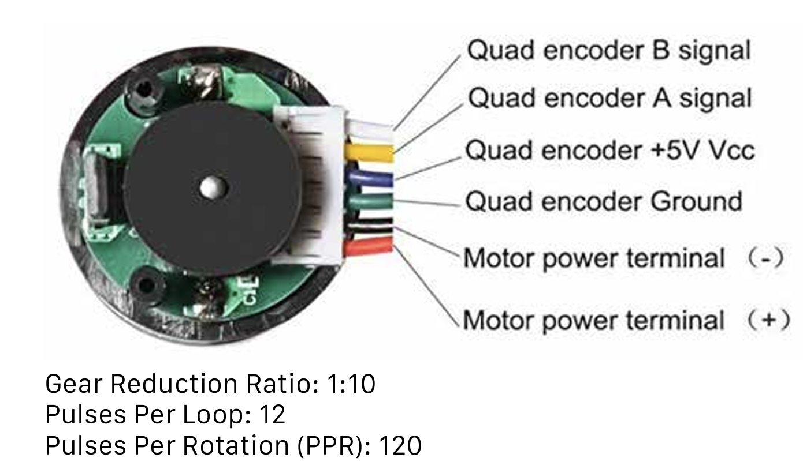
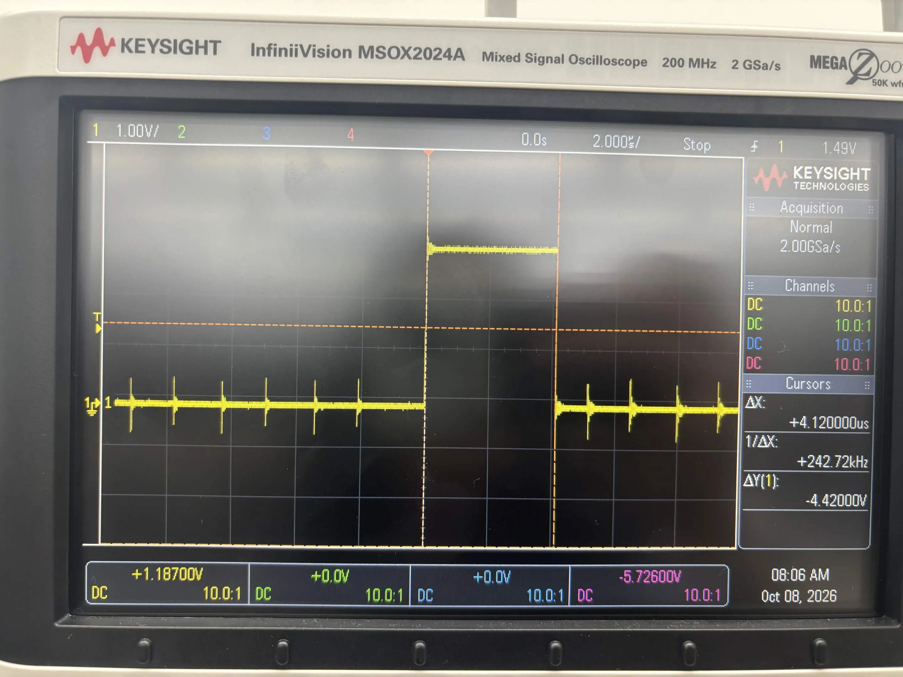
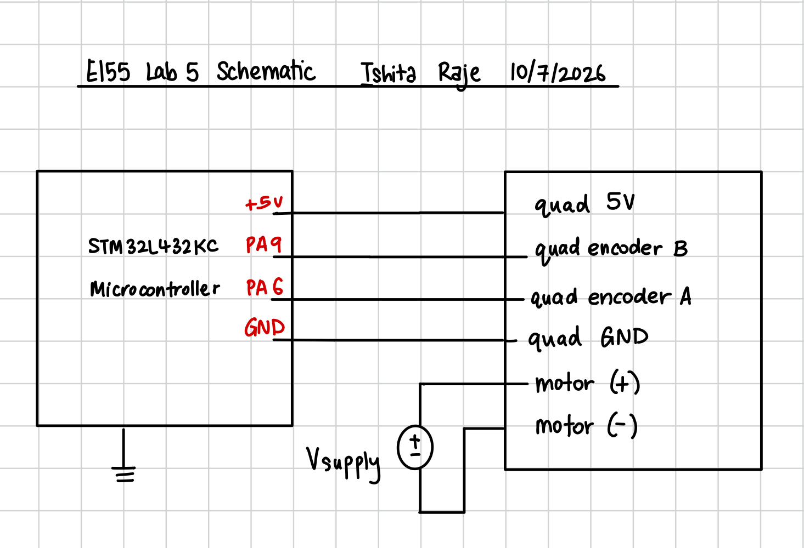
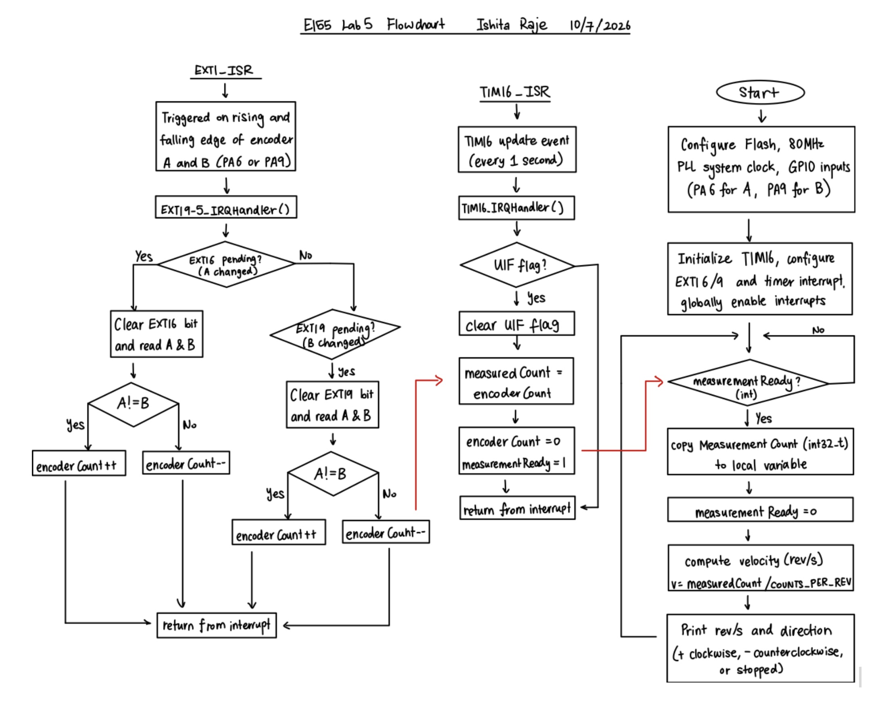

# Introduction 
In this lab , I developed a C program for the STM32L432KC microcontroller to read a quadrature encoder using interrupts and detect the rotational velcoity and direction of a DC motor. The  encoder generates two square-wave signals (A and B) at their output channels that are 90 degrees out of phase, allowing the determination of both the position and direction of rotation.

The encoder signals were read using external interrupts on the MCU rather than polling. Both the rising and falling edges of both encoders were monitored to maximize the resolution of the position measurement. A seperate timer interrupt was used to create a one-second time window, after which the number of encoder pulses was counted and used to calculate direction and velocity. The system was designed to update the velocity and direction at 1 Hz, providing a real-time measurement of the motor's performance.

# Design and Testing Methodology
## Overall C Code Structure
### Clock Configuration
The STM32L432KC was configured to run at 80 MHz using the internal MSI oscillator and the PLL. This ensured that the timers and GPIOs operated correctly for accurate encoder reading and timing. The code used the MCU's 4MHz MSI oscillator as the clock source, and the PLL was configured to multiply this frequency to achieve the desired system clock speed with the following settings: `configurePLL(PLLSRC_MSI, 1, 40, 2)`. The PLL clock was selected as the system clock source using `selectSysclk(SW_PLL)`. Before increasing the clock speed, the flash latency was set to 4 using  to ensure proper operation at higher frequencies. This system clockw as also used for the configuration of TIM16.

### Encoder GPIO Setup
The quadrature encoder's output channels were connected to GPIO pins PA6 and PA9 on the STM32L432KC, defined in main.h as ENCODER_A_PIN and ENCODER_B_PIN. The digitalRead() helper function reads the appropriate bit from the GPIO input data register (IDR). This was used inside the encoder interrupt handler to read the current states of A and B each time an encoder edge occurred.

### TIM16 and 1 Hz Configuration
TIM16 was used to create a fixed one second measurement interval. This served two purposes: it determined how long encoder pulses were accumulated before calculating velocity and controlled how often a new velocity value was printed in the terminal.

The timer was configured with a prescaler of 7999 to divide the system clock's 80MHz speed, giving a counter frequency of 10 kHz. The ARR was then calculated to be 9999, resulting in a timer overflow every 1 second. The timer configuration in `TIM16_init()` sets the peripheral clock, prescaler, auto-reload value, and forces an update so the settings take effect, clears the update flag, and starts the counter.

## Interrupts Configuration
The design used interrupts rather than polling so that encoder edges could be recorded immediately without requiring the main loop to continuously check the input pins.
The interrupt setup was written using the STM32 CMSIS register definitions. The project includes the ST device header called stm32l432xx.h, which defines the memory-mapped registers for the STM32L432KC. This allowed the peripherals to be configured without using the STM32 HAL library. 

For the encoder, the SYSCFG periperal was first enabled, followed by GPIO pin PA6 being routed to EXTI6 and PA9 being routed to EXTI9. The EXTI interrupt mask register (IMR) was then set to enable interrupts for both channels. The rising and falling edge triggers were enabled in the EXTI rising trigger selection register (RTSR) and falling trigger selection register (FTSR). Finally, the NVIC was configured to enable the EXTI9_5_IRQn interrupts, which correspond to the encoder channels. 

For TIM16, the timer's update interrupt was enabled in the DIER register, and the NVIC was configured to enable the TIM16_IRQn interrupt. This allowed the main loop to be interrupted every second to calculate and print the velocity and direction of the motor. Overall, the interrupt-based structure allowed encoder edges to be recorded independently of the main loop while TIM16 maintained a consistent one-second measurement interval.

## Interrupts vs Manual Polling
At high motor speeds, interrupt-based code is more reliable than manual polling because the encoder can change state much faster than the main loop may be able to check the GPIO pins. To check execution time of the interrupt handlers, the code used a GPIO pin to toggle a signal at the start and end of each interrupt. This allowed the duration of the interrupt to be measured using an oscilloscope. The oscilloscope measurements showed that the interrupt handler took approximately 4 µs to execute. Since the encoder produces 120 pulses per revolution, and given that we are counting rising and falling edges of both encoder channels, we can expect around 480 detectable transitions per revolution. At the maximum recorded motor speed of approximately 10.8 rev/s at 12V, this corresponds to approximately 193 µs between consecutive encoder transitions. Since the interrupt handler requires only 4 µs, it completes well before the next expected transition, demonstrating that the interrupt-based implementation can efficiently process encoder signals while allowing the CPU to perform other tasks between interrupts.

## Quadrature Encoder Logic
The quadrature encoder generates two square-wave signals, A and B, that are 90 degrees out of phase. These were montitored at both the rising and falling edges of both signals to maximize the resolution of the position measurement. The logic for determining direction is based on the state of the two signals at each edge transition whcih was handled by the interrupt functions. 

The current states of A and B were read using digitalRead() and the encoder count was incremented or decremented based on the direction of rotation. 

Because interrupts were generated from both encoder channels, the direction condition depended on which channel caused the transition. For an A transition, A != B represented one direction, while for a B transition, the same direction was represented by A == B. Using opposite comparisons for the two channels ensured that all four transitions in a quadrature cycle incremented the count in one physical direction and decremented it in the other. This allowed both encoder channels to improve resolution without their counts canceling each other.

## Recoding Pulses and Calculating Velocity
At the end of every 1 second interval, the signed variable encoderCount conatined information on both displacement and direction. A positive value indicated clockwise rotation, while a negative value indicated counter-clockwise rotation. The absolute value of encoderCount was used to calculate the velocity in counts per second.

Once the TIM16 interrupt occurred, the encoderCount was read and reset to zero for the next interval. The velocity and direction were then printed to the terminal.

This specific ([25GA-370 DC Motor](https://hmc-e155.github.io/lab/lab5/#:~:text=AI%20Prototype-,25GA%2D370,-Lab%205%3A%20Interrupts)) was specified as approximately 120 pulses per revolution. Since both edges of both encoder channels were counted, the code defined as 4 times the number of pulses per revolution, or 1632 counts per revolution. The velocity was thus calculated as:

$$
\text{velocity} = \frac{\text{encoder count}}{\text{count / revolution} \times 1\text{s}}
$$

$$
\text{velocity} = \frac{\text{measured Count}}{4*120} \quad (\text{rev/sec})
$$

main.c only performs this calculation whe. measurementReady is set, which occurs in the TIM16 interrupt handler. This ensures that the velocity is only calculated once per second, and that the encoderCount is reset for the next measurement interval.

# Technical Documnentation
## GitHub Repository
The code for this lab is available in the [GitHub repository](https://github.com/iraje02/E155_MicroPs/tree/98aef190d1c383e8a069f4c6e0d24b2c54776e4e/lab%205).

## Schematics Diagram

The motor was connected to the STM32L432KC. The motor encoder channels were connected to GPIO pins PA6 and PA9 (which were chosen since they were 5V tolerant), and the motor was powered by an external power supply. A common ground was established between the motor power supply and the microcontroller to ensure proper signal reference. 

## Flowchart Diagram
The flowchart below illustrates the main logic of the program, including the initialization of peripherals, the handling of encoder interrupts, and the calculation of velocity and direction.

# Conclusion
In conclusion, I successfully implemented an interrupt-based quadrature encoder system on the STM32L432KC to measure the rotational velocity and direction of a brushed DC motor. Both rising and falling edges of both encoder channels were used to improve the measurement resolution, while TIM16 generated a one-second measurement period.

The motor was measured at approximately 10.8 rev/s clockwise and counterclockwise at 12 V. The use of interrupts allowed for accurate and efficient handling of encoder signals, while the timer ensured consistent measurement intervals. The system was able to provide real-time feedback on the motor's performance and print the speed and direction, demonstrating the effectiveness of using interrupts. 

## Time Spent - 21 hours 

# AI Prototyping
The prompt given to Claude this week was: "Write me interrupt handlers to interface with a quadrature encoder. I’m using the STM32L432KC, what pins should I connect the encoder to in order to allow it to easily trigger the interrupts?"

It responded with "On STM32, each EXTI line is tied to a pin number, so PA0 and PB0 can't both be used as interrupt sources (both map to EXTI0). Lines 0 to 4 each get their own dedicated IRQ handler, while lines 5-9 and 10-15 share one. For a clean setup, put the encoder channels on two pin numbers in the 0-4 range.

On the Nucleo-32 (L432KC), the best options are:

Encoder signal	Pin	Nucleo label	EXTI line / handler
Channel A	PA0	A0	EXTI0 → EXTI0_IRQHandler
Channel B	PA1	A1	EXTI1 → EXTI1_IRQHandler

PB0 (D3) and PB1 (D6) also work, on the same EXTI0/EXTI1 lines. Just don't mix them with PA0/PA1. If your encoder has an index/button signal, PA3 (A2) or PA4 (A3) gives you EXTI3/EXTI4 with their own handlers too."

While this does seem to be a good suggestion, I needed to use pins that were 5V tolerant for the encoder signals, but also present on the ribbon cable connector on the breadboard, which would allow for easy connection to the motor. The pins I used were PA6 and PA9, which are both 5V tolerant and available on the ribbon cable connector. This allowed for a clean and reliable connection to the motor encoder signals while still being able to use interrupts for accurate counting.

Instead of checking A == B or A != B depending on which encoder channel interrupted, it stored the previous A/B state and used a 16-entry transition table to compare the previous and current encoder states. Overall, the AI prototype helped show a more robust alternative, but I chose the simpler A/B comparison method because it met the lab requirements and was easier to explain and verify experimentally.

  
Click to view the C code generated by Claude Sonnet 5

#include "stm32l432xx.h"

static volatile int32_t encoder_count = 0;
static volatile uint8_t prev_state = 0;   // (A<<1)|B

// Index = (prev_state << 2) | new_state
static const int8_t qem[16] = {
     0, +1, -1,  0,
    -1,  0,  0, +1,
    +1,  0,  0, -1,
     0, -1, +1,  0
};

static inline uint8_t read_encoder_state(void) {
    uint32_t idr = GPIOA->IDR;
    return (uint8_t)((((idr >> 0) & 1) << 1) | ((idr >> 1) & 1));  // A=PA0, B=PA1
}

static inline void encoder_update(void) {
    uint8_t new_state = read_encoder_state();
    encoder_count += qem[(prev_state << 2) | new_state];
    prev_state = new_state;
}

void encoder_init(void) {
    // Clocks
    RCC->AHB2ENR |= RCC_AHB2ENR_GPIOAEN;
    RCC->APB2ENR |= RCC_APB2ENR_SYSCFGEN;

    // PA0, PA1 as inputs with pull-ups
    GPIOA->MODER &= ~((3U << (0 * 2)) | (3U << (1 * 2)));
    GPIOA->PUPDR &= ~((3U << (0 * 2)) | (3U << (1 * 2)));
    GPIOA->PUPDR |=  ((1U << (0 * 2)) | (1U << (1 * 2)));

    // Route PA0 -> EXTI0, PA1 -> EXTI1 (port A = 0b0000)
    SYSCFG->EXTICR[0] &= ~(SYSCFG_EXTICR1_EXTI0 | SYSCFG_EXTICR1_EXTI1);

    // Unmask, trigger on rising and falling edges
    EXTI->IMR1  |= EXTI_IMR1_IM0  | EXTI_IMR1_IM1;
    EXTI->RTSR1 |= EXTI_RTSR1_RT0 | EXTI_RTSR1_RT1;
    EXTI->FTSR1 |= EXTI_FTSR1_FT0 | EXTI_FTSR1_FT1;

    // Capture initial state before enabling interrupts
    prev_state = read_encoder_state();

    NVIC_SetPriority(EXTI0_IRQn, 1);
    NVIC_SetPriority(EXTI1_IRQn, 1);
    NVIC_EnableIRQ(EXTI0_IRQn);
    NVIC_EnableIRQ(EXTI1_IRQn);
}

void EXTI0_IRQHandler(void) {
    if (EXTI->PR1 & EXTI_PR1_PIF0) {
        EXTI->PR1 = EXTI_PR1_PIF0;   // clear pending (write 1)
        encoder_update();
    }
}

void EXTI1_IRQHandler(void) {
    if (EXTI->PR1 & EXTI_PR1_PIF1) {
        EXTI->PR1 = EXTI_PR1_PIF1;
        encoder_update();
    }
}

int32_t encoder_get_count(void) {
    return encoder_count;   // 32-bit aligned read is atomic on Cortex-M4
}

