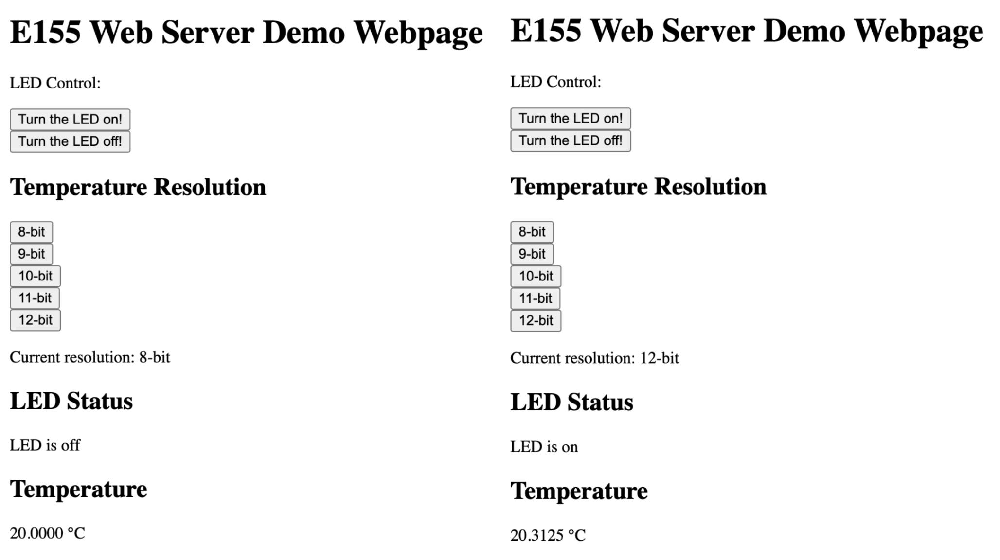
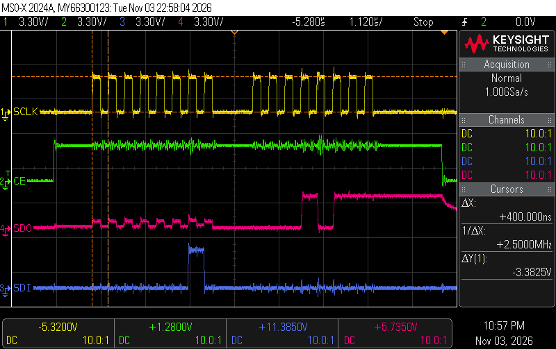
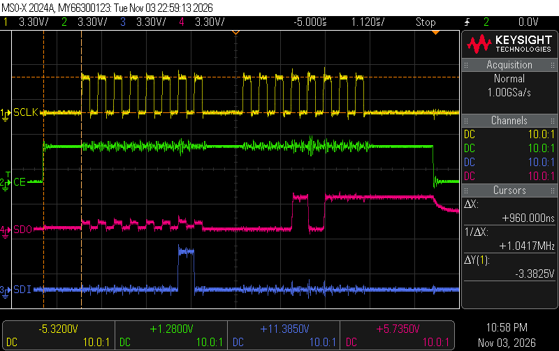
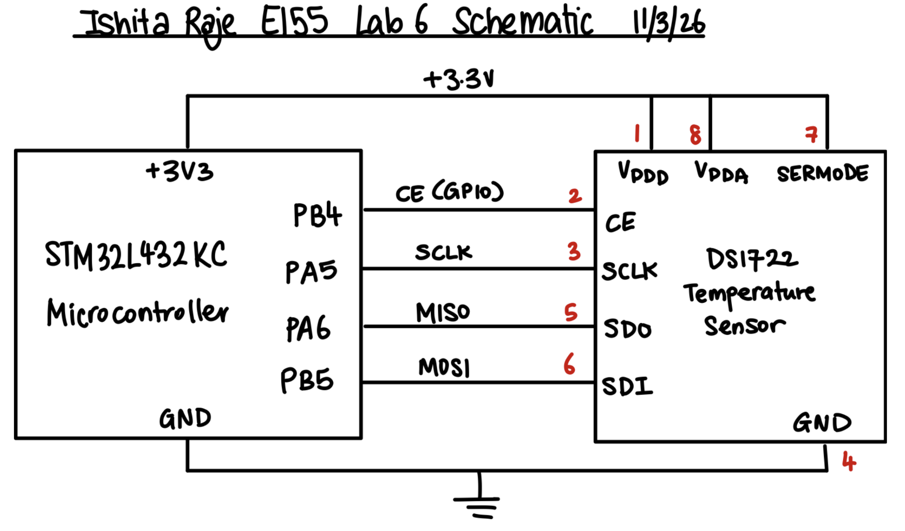
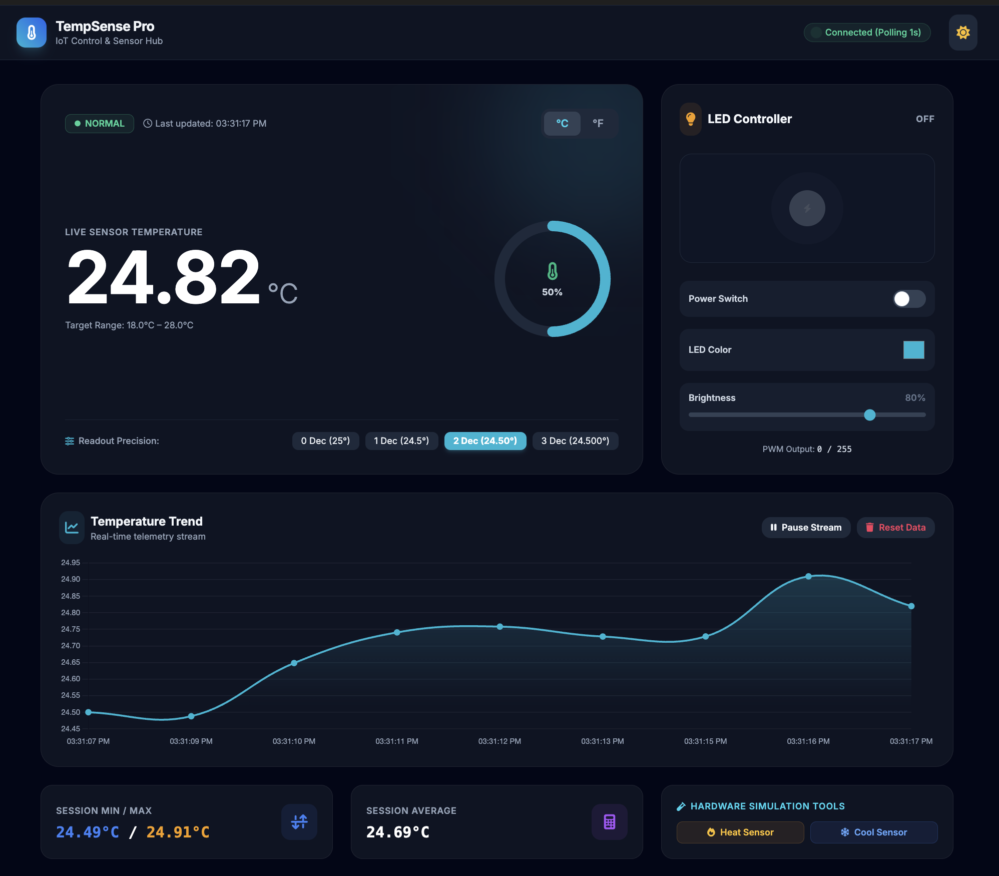

# Introduction
In this lab, I built an internet accessible device using the STM32L432KC microcontroller, a DS1722 digital temperature sensor, and an ESP8266 Wi-Fi module. The device hosts a webpage that lets users view the current ambient temperature which updated upon refresh, turn an onboard LED on and off, and choose the resolution of the temperature measurement (shown in ºC) (8, 9, 10, 11, or 12 bits) which controls the decimal places displayed and the accuracy of the measurement.

The MCU was configured to communicate with the DS1722 over SPI using a driver I wrote with the CMSIS register definitions in `stm32l432xx.h`. The MCU also communicates with the ESP8266 over UART at 125000 baud. When the user loads the webpage or clicks a button, the ESP8266 forwards the request to the MCU, and the MCU reads the sensor, updates the LED or resolution if requested, and sends back a complete HTML page for the ESP8266 to display. This lab demonstrates the use of SPI and UART communication protocols, as well as the integration of a microcontroller with a Wi-Fi module to create an IoT device.

# Design and Testing Methodology
## SPI Driver
The SPI driver was written using the CMSIS register structs and bit definitions from `stm32l432xx.h`. The `initSPI()` function first enables the SPI1 peripheral clock and configures PA5, PA6, and PB5 as alternate function 5 so they act as SCK, MISO, and MOSI. It then sets the MCU as the SPI master, sets the baud rate divider, clock polarity, and clock phase based on the temperature sensor specifications from the ([datasheet](https://hmc-e155.github.io/assets/doc/ds1722.pdf)). The `FRXTH` bit is set to get the flag which is raised as soon as one byte is available, and software slave management is enabled since the chip enable is controlled manually with a GPIO pin. Finally, the peripheral is enabled.

The SPI was initialized with a baud rate setting of 4, which divides the 80 MHz clock by 32 to give a 2.5 MHz SCK, which is below the DS1722's 5 MHz maximum. CPHA was set to 1 because the DS1722 shifts data out on one clock edge and samples it on the next. The `spiSendReceive()` function waits until the transmit buffer is empty, writes a byte to the data register, waits until a byte has been received, and returns it. Both the write and the read access the data register so that the hardware performs the necessary 8-bit transfers.

## DS1722 Temperature Sensor Driver
The DS1722 is wired in SPI mode by connecting its SERMODE pin to 3.3V (PIN 7). Its chip enable is active high, so PB4 is driven high at the start of each transaction and low at the end and every exchange consists of an address byte followed by a data byte. Writing to the configuration register uses address 0x80, while the temperature is read from address 0x02 for the most significant byte (MSB) and address 0x01 for the least significant byte (LSB).

### Resolution
The resolution is set by writing the sensor's configuration register, whose bits are `1 1 1 SHOT R2 R1 R0 SD`. The `setResolution()` function keeps SHOT and SD at 0 so the sensor converts continuously, and sets bits R2 through R0 to a value from 0 to 4, which selects 8 to 12 bits of resolution. This gives a configuration byte of 0xE0 | ((bits - 8) << 1), so 8-bit is 0xE0 and 12-bit is 0xE8. Each additional bit halves the temperature step size, from 1 °C at 8-bit down to 0.0625 °C at 12-bit, but also doubles the conversion time, from 75 ms at 8-bit up to 1.2 s at 12-bit. The sensor starts at 9-bit resolution when the program begins as the default resolution.

### Temperature Conversion
The readTemperature() function reads the MSB and LSB in two separate transactions. The MSB holds the whole number part of the temperature in two's complement, and the upper bits of the LSB hold the fractional part, with bit 7 worth 0.5 °C, bit 6 worth 0.25 °C, and so on down to 0.0625 °C. The unused lower bits always read as zero. Combining the two bytes into one 16-bit value gives a number equal to the temperature multiplied by 256, so the temperature is found by:

$$
T = \frac{(\text{MSB} \ll 8) \,|\, \text{LSB}}{256} \quad (^\circ\text{C})
$$

The combined value is cast to a signed 16-bit integer before dividing, which keeps the sign so negative temperatures convert correctly. Since every resolution uses the same bit positions, this single equation works for all five settings and covers the full −10 °C to 30 °C range. For example, a reading of MSB = 0x19 and LSB = 0x10 gives 6416 / 256 = 25.0625 °C, and a reading of MSB = 0xF5 and LSB = 0x80 gives −2688 / 256 = −10.5 °C.

When I first connected the sensor, both bytes read as zero. This was caused by a bug in `spiSendReceive()`, where the value of the data register was being dereferenced instead of its address. After fixing this, the sensor read room temperature, about 20.5 °C at 9-bit resolution.

## Webpage and Main Loop
The ESP8266 plugs into the mikroBUS socket on the development board, which connects it to USART1 on the MCU. It creates its own Wi-Fi network and hosts the webpage at `http://192.168.4.1`. When a browser loads the page or a button is clicked, the ESP8266 sends the MCU a request of the form `/REQ:<tag>\n`, where the tag is the name of the button's action, such as `ledon` or `res12`. The MCU must then send back a complete HTML page, and the ESP8266 forwards it to the browser once it sees `</html>` or once 200 ms pass without new data.

The main loop handles one request each time it runs. It first reads characters from the UART into a buffer until it receives a newline. It then checks the ledon, ledoff, res8, res9, res10, res11, and res12 tags to see if the user requested a change. If the request is for `ledon`, it turns on the LED on PB3, if `ledoff`, it turns off the LED. If the request is for one of the resolution buttons, it writes the new configuration to the DS1722. After any changes, it reads and formats the temperature from the sensor and sends the complete HTML page back to the ESP8266. The page includes the current temperature, the LED status, and buttons for turning the LED on or off and for selecting the resolution. Because the MCU reads the sensor on every request, the temperature updates each time the page is refreshed.

Below are the screenshots of the webpage at 8-bit and 12-bit resolution, showing the temperature in ºC with one and four decimal places, respectively as well as one with the LED on and off.

## SPI Oscilloscope Capture
In order to verify that the SPI communication was working correctly, I used an oscilloscope to capture the signals on the SPI lines. The capture shows the clock (SCK), master out slave in (MOSI), and master in slave out (MISO) signals during a temperature read operation. The timing, frequencies and voltages were checked againts the datasheet and shows expected behavior. 

The captures below show a full SPI read of the DS1722's temperature MSB. CE goes high to start the transaction and stays high for both bytes. In the first byte, the MCU sends the address 0x02 on SDI. In the second byte, the MCU sends 0x00 while the DS1722 shifts out the temperature MSB on SDO, which reads 0x17 (23°C). SCLK idles low since polarity was set to 0, and data is shifted on the rising edge and sampled on the falling edge.

The measured timings also match the expected values. The SCK frequency was measured at 2.5 MHz, which is below the DS1722's maximum of 5 MHz. CE rises 960 ns before the first SCLK edge, above the 400 ns minimum. CE also stays high for about 1.7 µs after the last SCLK edge, above the 100 ns minimum.

# Technical Documentation
## GitHub Repository
The code for this lab is available in the [GitHub repository](https://github.com/iraje02/E155_MicroPs/tree/main/lab06).

## Schematic Diagram
The DS1722 was wired on the breadboard with SCK connected to PA5, SDO to PA6, SDI to PB5, and CE to PB4. SERMODE was tied to 3.3 V to select SPI mode. The ESP8266 was plugged into the mikroBUS socket, which connects it to USART1 on the MCU. The onboard LED is connected to PB3. The FPGA DIP switches were left open so the FPGA would not interfere with the MCU's pins.

# Conclusion
In conclusion, I built an internet-accessible temperature monitor using the STM32L432KC, a DS1722 temperature sensor, and an ESP8266. I wrote an SPI driver using the CMSIS register definitions and a DS1722 driver that supports all five resolution settings and correctly converts both positive and negative temperatures. The webpage displays the current temperature, which updates on refresh, lets the user turn the LED on and off, and lets the user change the sensor's resolution. The design meets all of the lab requirements.

## Time Spent - 15 hours

# AI Prototype 
This week's prompt was "I’m making a web portal to interface with a temperature sensor. Create a HTML page that looks good and is intuitive to show the temperature, control an LED, and change the precision of the readout." For this I used Gemini to generate a prototype of the webpage. The generated HTML was then modified to include the correct tags for the ESP8266 to send requests to the MCU, and to display the current temperature and LED status. The buttons for turning the LED on and off and for changing the resolution were also added. The final webpage is shown in the screenshots below. While aesthetically pleasing, the HTML shows assumptions made about the LED where I would be able to adjust the color of the LED, which is not possible with the hardware. 

The LLM generated a C function to read the temperature from the DS1722. Like my driver, Gemini used the CMSIS register definitions, drove the active-high chip enable, and accessed the SPI data register through an 8-bit pointer. Unlike mine, it read the LSB and MSB in a single burst transaction using the sensor’s address auto-increment, which is more efficient than my two separate transactions. Its conversion was wrong for negative temperatures since it subtracted the fractional part when the MSB was negative, so −10.5 °C would read as −11.5 °C. My driver avoids this by combining both bytes into a signed 16-bit value and dividing by 256. Overall, the generated code was a useful reference, but it needed careful checking against the datasheet before it could be trusted.

  
Click to view the C code generated by Gemini

#include "stm32l432xx.h"
#include <stdint.h>

/**
 * @brief  Reads temperature from the DS1722 sensor via SPI.
 * @note   Assumes GPIOA Pin 4 (PA4) is used as software Chip Enable (CE).
 *         Adjust GPIO port/pin to match your hardware layout.
 * @param  spi Pointer to SPI peripheral instance (e.g., SPI1)
 * @return Temperature in degrees Celsius as a float. Returns -999.0f on error.
 */
float DS1722_ReadTemperature(SPI_TypeDef *spi)
{
    uint8_t address = 0x01; // Base address: LSB = 0x01, MSB = 0x02 (Read bit 7 = 0)
    uint8_t raw_lsb = 0;
    uint8_t raw_msb = 0;

    // 1. Assert Chip Enable (CE HIGH for DS1722)
    GPIOA->BSRR = GPIO_BSRR_BS4; 

    // 2. Transmit Read Address (0x01)
    // Wait until transmit buffer is empty (TXE)
    while (!(spi->SR & SPI_SR_TXE));
    
    // Force 8-bit access to DR register (STM32L4 FIFO handling)
    *(__IO uint8_t *)&spi->DR = address;

    // Wait until receive buffer is not empty (RXNE) to clear RX FIFO from address write
    while (!(spi->SR & SPI_SR_RXNE));
    (void)*(__IO uint8_t *)&spi->DR; // Read and discard dummy byte

    // 3. Read LSB byte (send dummy 0xFF to drive clock)
    while (!(spi->SR & SPI_SR_TXE));
    *(__IO uint8_t *)&spi->DR = 0xFF;

    while (!(spi->SR & SPI_SR_RXNE));
    raw_lsb = *(__IO uint8_t *)&spi->DR;

    // 4. Read MSB byte (send dummy 0xFF to drive clock)
    while (!(spi->SR & SPI_SR_TXE));
    *(__IO uint8_t *)&spi->DR = 0xFF;

    while (!(spi->SR & SPI_SR_RXNE));
    raw_msb = *(__IO uint8_t *)&spi->DR;

    // Wait until SPI is no longer busy before dropping CE
    while (spi->SR & SPI_SR_BSY);

    // 5. De-assert Chip Enable (CE LOW)
    GPIOA->BSRR = GPIO_BSRR_BR4;

    // 6. Convert Raw Data to Temperature
    // MSB contains 8-bit signed two's complement integer portion.
    // LSB upper bits contain fractional portion depending on configured resolution.
    int8_t sign_magnitude = (int8_t)raw_msb;
    float fractional = (raw_lsb >> 4) * 0.0625f; // Up to 12-bit resolution (0.0625°C/LSB)

    if (sign_magnitude < 0) {
        return (float)sign_magnitude - fractional;
    } else {
        return (float)sign_magnitude + fractional;
    }
}

