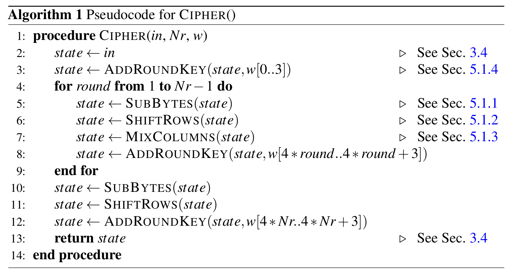
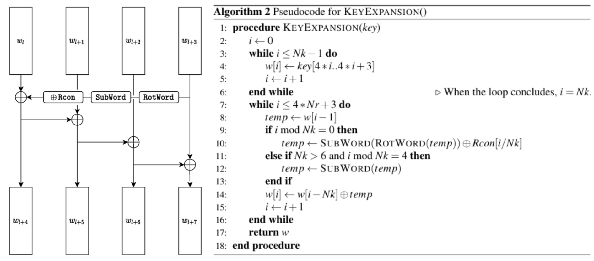
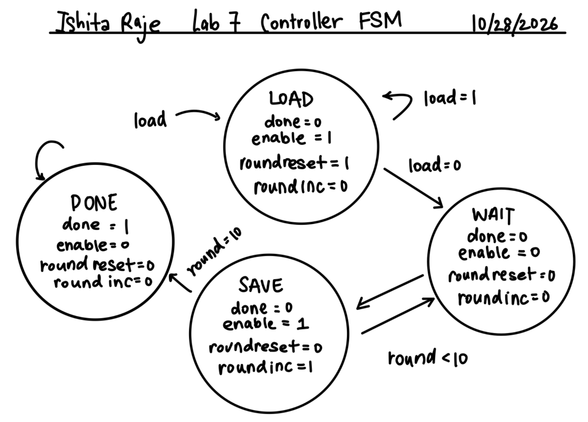
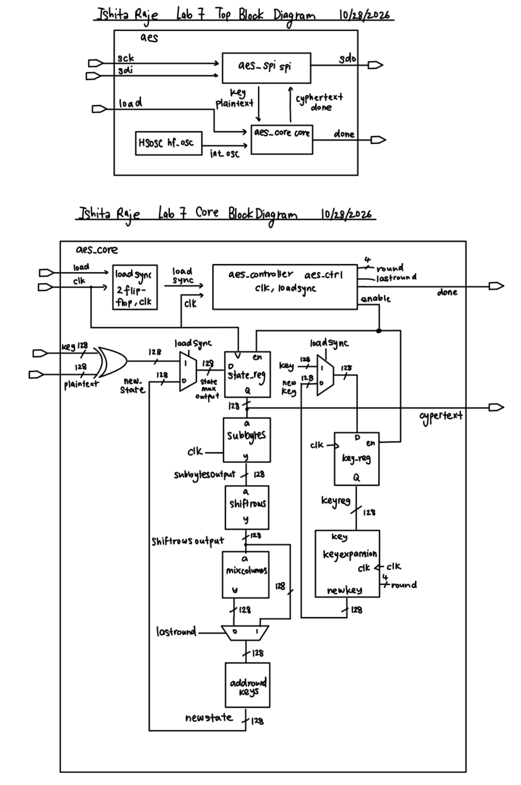
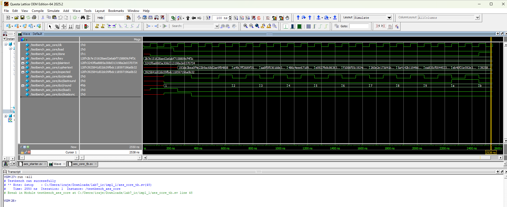
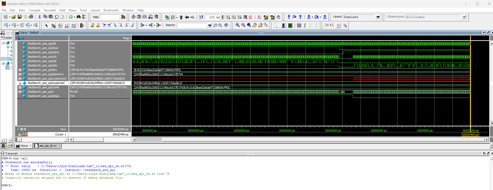

# Introduction
In this lab, I explored the Advanced Encryption Standard (AES) algorithm and built a hardware implementation on the iCE40 UltraPlus FPGA that performed a 128-bit AES encryption, following the ([NIST FIPS-197 specification](https://hmc-e155.github.io/assets/doc/NIST.FIPS.197-upd1.pdf)). The microcontroller was also used to send a 128-bit plain text message and a 128-bit key to the FPGA for encryption over SPI, and the MCU read the 128-bit ciphertext back and checks it against the expected answer from Appendix A.1 and B of the linked standard.

AES scrambles a message over ten rounds. Each round applies four steps to a 4x4 grid of bytes called the state: SubBytes, ShiftRows, MixColumns, and AddRoundKey. Additionally there is a separate key expansion process that is used to generate new 128-bit round keys from the original 128-bit key. The full encryption process is very large to build as one block of combinational logic on the FPGA, thus the design helps perform the same AES technique, but only one round at a time and uses the hardware ten different times, with a finite state machine controller helping to sequence the rounds.

The MCU and SPI interface were provided, so the main work for this lab was designing, testing and debugging the aes_core_module on the FPGA and then getting it to work on hardware.

# Design and Testing Methodology
## AES Algorithm Specifications
Before writing the code for this lab, I read through Section 3 to 5.2 of the FIPS 197 specification to understand the details of the AES algorithm, including the structure of the state, the round transformations, and the key expansion process. One detail that mattered throughout the lab is how the state is packed into a 128-bit bus. The bytes fill the 4x4 grid down each column, not across each row, so each 32-bit word of the bus is one column of the state. This means the byte in row r and column c sits at bits [127 - 8(4c + r)] down to 8 bits below that, a formula I used in several modules.

/

## Datapath Design
The datapath has two 128-bit registers: a state register and a key register. The load signal from the MCU is first synchronized to the FPGA clock by passing it through two flip-flops in series, and only the synchronized version is used inside aes_core. While the synchronized load is high, a mux loads the state register with the plaintext XORed with the key, and a second mux loads the key register with the original key. After loading, each round sends the state register through SubBytes, ShiftRows, MixColumns and AddRoundKey and saves the result back into the state register. At the same time, the key register goes through key expansion and the new round key is saved back into the key register. Both registers are clocked by the system clock and only save when the controller asserts enable.

## SubBytes
The SUbBytes step replaces each of the 16 bytes of the state with a value from the S-box lookup table. I used 16 instances of the provided sbox_sync module, oen per byte. In each instance, one byte of the state feeds into the sbox_sync module and the output is written into the same byte position of the state, since SubBytes only changes the value, not the position. The sbox_sync module is stored in teh FPGA's embedded blcok RAM rather than logic cells, which is what allows the deisgn to fiton the chip. Given that block RAM is synchronous, the output of the sbox module is available one clock cycle after the input is provided.

## ShiftRows
The ShiftRows step cyclically shifts the bytes in each row of the state to the left by a certain offset. Row 0 is left unchanges, and row 1 is shifted by 1 byte, row 2 by 2 bytes, and row 3 by 3 bytes. This step helps to provide diffusion by mixing the bytes across columns. In hardware this only involved rewiring, and in grid form, the output row r and column c comes from input row r and column (c + r) mod 4 in order to handle the wrap around.

## MixColumns
The MixColumns step takes each column of the state and transforms it using a fixed matrix multiplication in the finite field GF(2^8). This step further mixes the four bytes in each column using Galois field arithmetic, so that every output byte depends on all four input bytes of the column. In hardware, this is typically implemented using combinational logic that performs the necessary finite field multiplications and XOR operations, which was provided to us in the lab. Since the last round of the AES encryption skips MixColumns, I added a bypass mux after this module that selects either the output of MixColumns or output of ShiftRows based on whether it is the last round.

## AddRoundKey
The AddRoundKey was the easiest step to implement, as it simply involves a 128-bit XOR between the current state and the round key.

## Key Expansion
The key expansion module computes the next round key from the current one, following Figure 6 from the FIPS 197 specification shown below. The current key is split into 4 32-bit words, and the last word is put through the three steps of rotation (RotWord) which moves the first byte to the end, S-box substitution of each of the 4 bytes (SubWord) using sbox_sync, and finally XORing with the round constant (Rcon). Since only the top byt of Rcon is ever non-zero, it meant that only the top byte of SubWord result is ever changing.

It involves rotating the last word of the current key, applying the S-box to each byte, XORing with a round constant, and then XORing with the corresponding word of the previous round key to generate the new round key. This process is repeated for each word of the key to produce the complete next round key.

Rcon doubles each round, going from 01 in round 1 to 1B in round 9 and 36 in round 10, and I implemented it as a case statement on the round number. The four new words are then computed as a chain of XORs, where each new word depends on the one just created. Since both key expansion and SubBytes use synchronous S-boxes, the new state and the new round key are ready on the same clock cycle.

## Controller FSM
The controler was a separate module I created that contained a four-state FSM and a round counter as shown below.
- **LOAD:** The FSM entered the LOAD state whenever load was high, and the round counter is set to 1.
- **WAIT:** In the WAIT state, the registers hold their values while the S-boxes look up their outputs. This state was necessary because of the one-cycle latency of the synchronous S-boxes. If the registers saved on the first clock edge of a round, they would capture the previous round’s S-box output. Each round therefore takes two clock cycles: one for the S-box lookup and one to save the result.
- **SAVE:** In the SAVE state, the S-box outputs are now valid, so enable is asserted and both registers save the finished round, and the round counter increments. If the round was 10, the FSM moves to DONE, otherwise it returns to WAIT.
- **DONE:** In the DONE state, done is asserted and held, keeping the ciphertext stable until the next load.

The outputs of the controller are the enable signal, the round counter, and the done signal, which indicate when the datapath should save the current round, which round is currently being processed, and when the encryption is complete, respectively.

## Top-Level Module
The provided aes module has clk as an input. I wanted to use the iCE40’s internal high-speed oscillator instead of an external clock, thus inside the top-module aes, I instantiated the HSOSC and passed its output to aes as the clock. The HSOSC was configured with CLKHF_DIV = 00, giving a 48MHz clock, similar to what I have used in previous labs.

## SPI Interface
The MCU and FPGA are connected through the SW7 DIP switch on the E155 development board. Using the pin definitions in STM32L432KC_SPI.h and lab7.c together with the board schematic, I assigned the FPGA pins as follows: sck to FPGA pin 21 (MCU PB3), sdi to pin 10 (MCU PB5), sdo to pin 12 (MCU PB4), load to pin 26 (MCU PA5), and done to pin 27 (MCU PA6). PA11 is toggled by the MCU around each byte as an artificial chip-select. It is not used by the FPGA, but it allows the oscilloscope to decode the SPI bytes.

# Technical Documentation
## GitHub Repository
The code for this lab is available in the [GitHub repository](https://github.com/iraje02/E155_MicroPs/tree/main/lab%207).

## Block Diagram
The image below showsn the block diagram for the AES accelerator.The controller FSM helped drive the enable, round and lastround signals while the datapath contains the state and key registrats, SubBytes, ShiftRows, MixColumns, and AddRoundKey modules that were instantiated and connected to form the complete AES round.

# Results and Discussion
## Core Testbench (aes_core_module)
The testbench_aes_core testbench applies the FIPS-197 Appendix B key and plaintext to aes_core and checks the ciphertext once done is asserted. The design passed and produced the expected ciphertext 3925841d02dc09fbdc118597196a0b32. Waveform below shows the simulation results for the testbench.

## Full System Testbench
The testbench_aes_spi testbench shifts the plaintext and key into the full aes module over SPI, waits for done, and shifts the ciphertext back out. The design passed this testbench as well. Waveform below shows the simulation results for the testbench.

## Hardware
After programming the FPGA and flashing the MCU, the MCU’s success LED (PA9) lit up, confirming that the FPGA returned the correct ciphertext. However, my first hardware version was unreliable: pressing the MCU reset button sometimes lit the success LED and sometimes lit the failure LED (PA10). Since the pins, SPI and S-boxes were all clearly working on the passing runs, the issue was likely related to timing or reset synchronization between the MCU and FPGA.

After debugging, I found that the cause was the unsynchronized load signal described above. After adding the two-flip-flop synchronizer, the success LED lit on every reset.

## Time Spent - 27 hours

# AI Prototyping
To test whether withholding a specification changes the quality of LLM-generated HDL, I gave Google Gemini the key expansion task twice: once with the FIPS-197 document, and once with only the pseudocode, the key steps renamed to module1 and module2, and an instruction not to use any knowledge of AES.

The LLM prompt was: "Write SystemVerilog HDL to implement the KeyExpansion logic described in the FIPS-197 uploaded document. The module should be purely combinational, using the previous key and current round number to calculate the next key. Assume other required modules (SubWord and RotWord) are already implemented."

The two outputs were almost identical and both matched my own key expansion module. The only differences were stylistic, such as using a function versus an always_comb case statement for the Rcon lookup. Even without the specification, Gemini named the module aes_key_expansion_round, used RotWord and SubWord instead of module1 and module2, and filled in the exact Rcon values, which were never given. Because AES is a public standard the model already learned during training, withholding the specification did not change the output. A truly confidential specification would not be in the training data, so I would expect the output to depend much more on how clear the prompt is.

Neither version accounted for my hardware either: both assume SubWord is combinational, while my design uses synchronous block-RAM S-boxes that need an extra clock cycle. Next time, I would give the LLM my design constraints along with the specification, and check its output against the Appendix A.1 test vectors before using it.

 
Click to view the code generated by Google Gemini with the FIPS-197 AES Specifications

 // SystemVerilog Module for AES-128 Key Expansion (Combinational, Single-Round)
module aes_key_expansion_128 (
   input  logic [127:0] prev_key,   // 128-bit key from previous round (w[4r-4 .. 4r-1])
   input  logic [3:0]   round_num,  // Current round index (1 to 10)
   output logic [127:0] next_key    // 128-bit key generated for the next round (w[4r .. 4r+3])
);

   // Unpack 128-bit previous key into four 32-bit words: w0, w1, w2, w3
   logic [31:0] w0, w1, w2, w3;
   assign {w0, w1, w2, w3} = prev_key;

   // SubWord and RotWord interface signals
   logic [31:0] rot_word_out;
   logic [31:0] sub_word_out;

   // External word transformation modules as assumed by specification
   RotWord u_rotword (
       .in  (w3),
       .out (rot_word_out)
   );

   SubWord u_subword (
       .in  (rot_word_out),
       .out (sub_word_out)
   );

   // Round Constant Lookup Function (Rcon[j] where j = round_num)
   function automatic logic [31:0] get_rcon(input logic [3:0] rnd);
       case (rnd)
           4'd1:  get_rcon = 32'h01_00_00_00;
           4'd2:  get_rcon = 32'h02_00_00_00;
           4'd3:  get_rcon = 32'h04_00_00_00;
           4'd4:  get_rcon = 32'h08_00_00_00;
           4'd5:  get_rcon = 32'h10_00_00_00;
           4'd6:  get_rcon = 32'h20_00_00_00;
           4'd7:  get_rcon = 32'h40_00_00_00;
           4'd8:  get_rcon = 32'h80_00_00_00;
           4'd9:  get_rcon = 32'h1B_00_00_00;
           4'd10: get_rcon = 32'h36_00_00_00;
           default: get_rcon = 32'h00_00_00_00;
       endcase
   endfunction

   // Key Expansion logic for generating next round's four words:
   // w4 = w0 ^ SubWord(RotWord(w3)) ^ Rcon
   // w5 = w1 ^ w4
   // w6 = w2 ^ w5
   // w7 = w3 ^ w6
   logic [31:0] w4, w5, w6, w7;

   assign w4 = w0 ^ sub_word_out ^ get_rcon(round_num);
   assign w5 = w1 ^ w4;
   assign w6 = w2 ^ w5;
   assign w7 = w3 ^ w6;

   // Pack output 128-bit key
   assign next_key = {w4, w5, w6, w7};

endmodule

 
Click to view the code generated by Google Gemini without the FIPS-197 AES Specifications

module aes_key_expansion_round (
   input  logic [127:0] prev_key,      // Key from previous round
   input  logic [3:0]   round_num,     // Current round number (1 to 10)
   output logic [127:0] next_key       // Expanded key for current round
);

   // Split 128-bit input key into four 32-bit words
   logic [31:0] w0, w1, w2, w3;
   assign w0 = prev_key[127:96];
   assign w1 = prev_key[95:64];
   assign w2 = prev_key[63:32];
   assign w3 = prev_key[31:0];

   // Intermediate signals for transformation chain
   logic [31:0] rot_w3;
   logic [31:0] sub_rot_w3;
   logic [31:0] rcon;

   // Instantiate RotWord (cyclic byte left-shift: [a0,a1,a2,a3] -> [a1,a2,a3,a0])
   RotWord rot_inst (
       .in  (w3),
       .out (rot_w3)
   );

   // Instantiate SubWord (S-box substitution applied to each byte)
   SubWord sub_inst (
       .in  (rot_w3),
       .out (sub_rot_w3)
   );

   // Round Constant Lookup Table (Rcon[i] in GF(2^8) padded to 32 bits)
   always_comb begin
       case (round_num)
           4'd1:  rcon = 32'h01_00_00_00;
           4'd2:  rcon = 32'h02_00_00_00;
           4'd3:  rcon = 32'h04_00_00_00;
           4'd4:  rcon = 32'h08_00_00_00;
           4'd5:  rcon = 32'h10_00_00_00;
           4'd6:  rcon = 32'h20_00_00_00;
           4'd7:  rcon = 32'h40_00_00_00;
           4'd8:  rcon = 32'h80_00_00_00;
           4'd9:  rcon = 32'h1B_00_00_00;
           4'd10: rcon = 32'h36_00_00_00;
           default: rcon = 32'h00_00_00_00;
       endcase
   end

   // Compute new 32-bit words combinatorially
   logic [31:0] next_w0, next_w1, next_w2, next_w3;

   assign next_w0 = w0 ^ sub_rot_w3 ^ rcon;
   assign next_w1 = w1 ^ next_w0;
   assign next_w2 = w2 ^ next_w1;
   assign next_w3 = w3 ^ next_w2;

   // Concatenate resulting words into 128-bit output key
   assign next_key = {next_w0, next_w1, next_w2, next_w3};

endmodule

